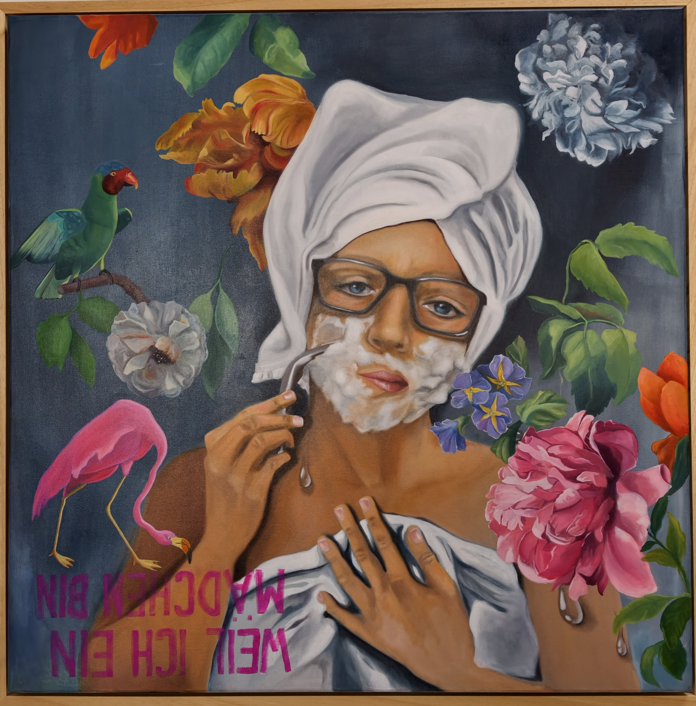

# Weil ich ein Mädchen bin - Puzzle

**Titel:** Weil ich ein Mädchen bin - Puzzle  
**Technik:** Öl auf Leinwand  
**Größe:** 100 × 100 × 4,5 cm  
**Jahr:** 2026  
**Preis:** € 3.600

## Bildbeschreibung

"Weil ich ein Mädchen bin"ist kein Statement über Identität,- es ist eine Einladung,sie zu denken,zu fühlen,zu verschieben. 
Zwischen Blüten und Rasierschaum, Ironie und Intimität eröffnet sich ein zarter,aber kraftvoller Dialog über Geschlecht, Selbstbild und gesellschaftlicher Erwartung.Kunstals Spiegel ,Puzzle und Spiel zugleich - ein Prozess der nicht endet,solange jemand hinsieht.
